# 🤖 ZARVIS — AI Command Intelligence

[](LICENSE)
[]()
[]()
[]()
[]()

> **Z**ero-latency **A**I **R**esponse and **V**oice **I**ntelligence **S**ystem — A futuristic, multimodal AI personal command center powered by **Google Gemini**, **FastAPI**, **WebSockets**, and **Web Speech API**. Talk, think, analyze, and execute in real time.

---

## 📸 Complete Visual Walkthrough & Interface Showcase

### 1. ⚡ Cybernetic System Boot & Diagnostic Sequence
*Multi-stage startup initialization running automated health checks across AI Core, Voice Engine, Memory Matrix, Modular Tools, and Google Gemini connectivity with rotating SVG gyroscopic rings.*

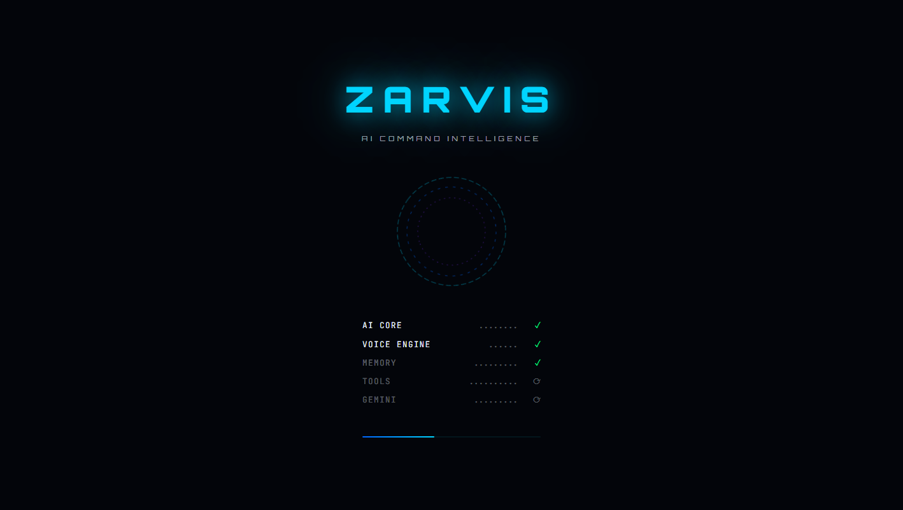

---

### 2. 🌐 Futuristic Landing Portal
*High-contrast dark glassmorphism hero portal introducing ZARVIS capabilities — Voice AI, Gemini Intelligence, Real-Time Tool Execution, Persistent Memory, Multimodal File Ingestion, and Privacy-First Architecture.*

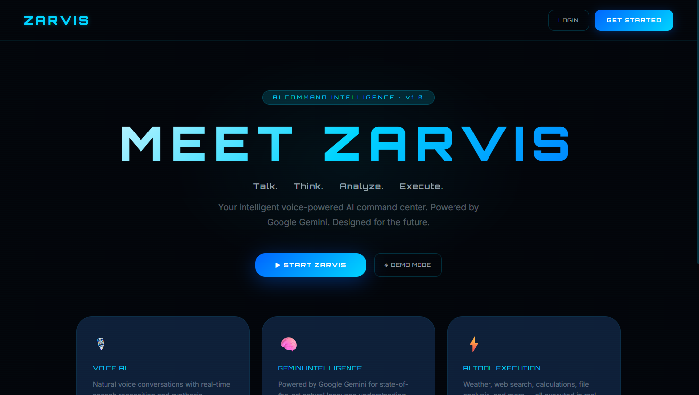

---

### 3. 🔐 Commander Authentication & Access Gateway
*Secure JWT-backed authentication terminal supporting Commander Login, new account registration, and instant 1-click **Offline Demo Mode** bypass.*

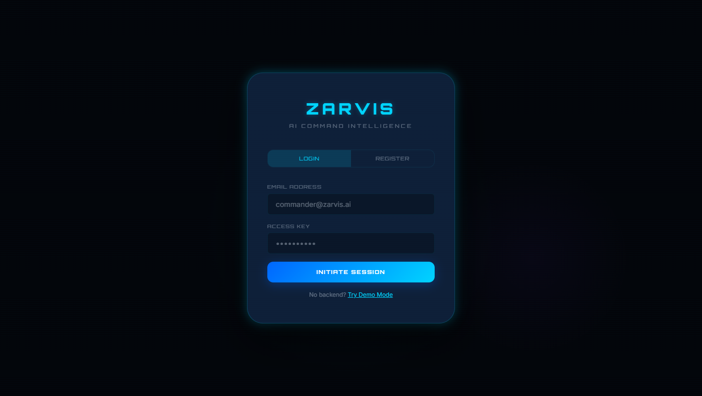

---

### 4. ◉ ZARVIS AI Core & Real-Time Command Center
*The primary operational HUD featuring a 60fps HTML5 Canvas reactive AI Core, live telemetry status bar (`AI`, `MIC`, `MEM`), dynamic personality switcher (Professional, Friendly, Concise, Technical, Creative, Researcher, Executive), and streaming Markdown conversation panel.*

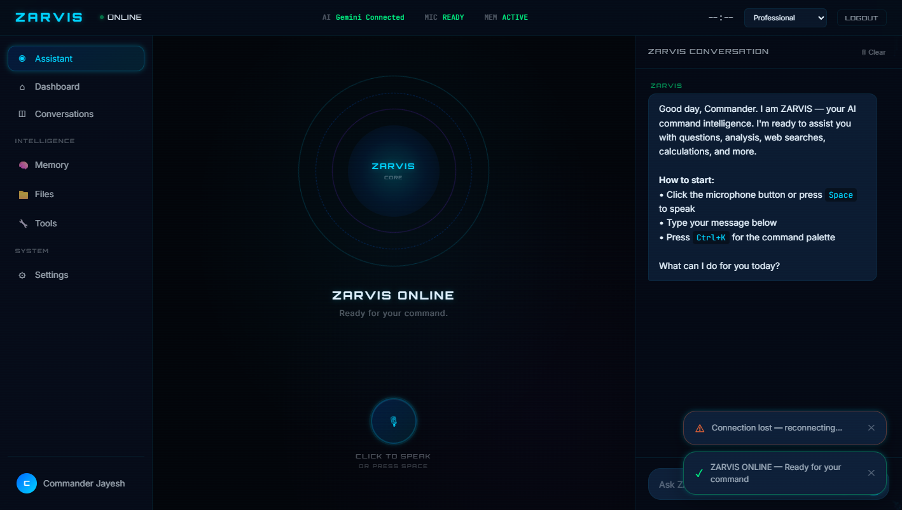

---

### 5. 🎙️ Real-Time Voice Interaction & Audio Waveform Visualizer
*Bi-directional speech pipeline with Speech-to-Text (STT), Text-to-Speech (TTS), barge-in interruption support, and live frequency waveform canvas visualization.*

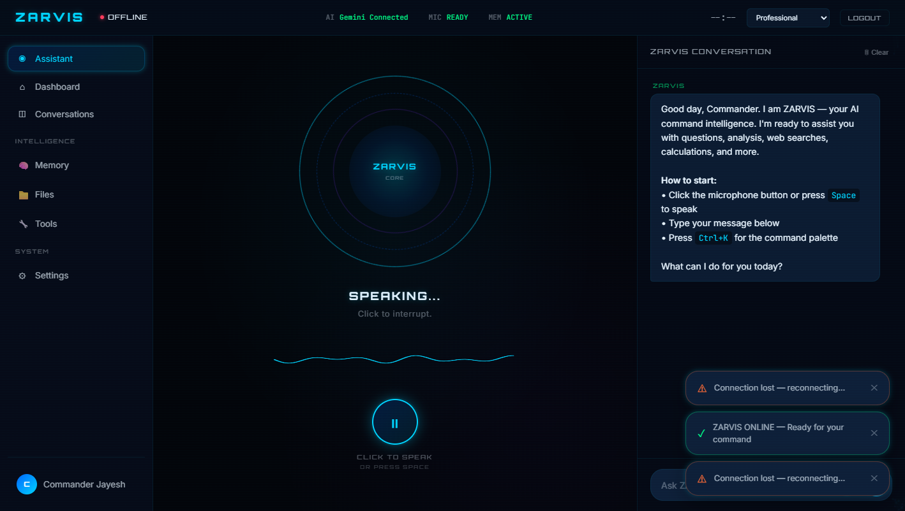

---

### 6. 🛠️ Autonomous AI Tool Execution & Streaming Cards
*Live in-chat tool invocation displaying real-time execution cards for meteorological weather telemetry, sandboxed mathematical calculations, web search, and system diagnostics.*

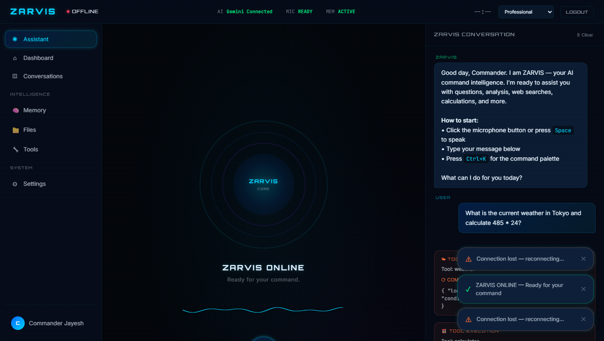

---

### 7. 📊 System Telemetry & Executive Dashboard
*Centralized command overview displaying active session metrics (Conversations, Messages, Stored Memories, Indexed Files), 1-click Quick Action launchers, live CPU/Memory/Network resource bars, and Gemini model status.*

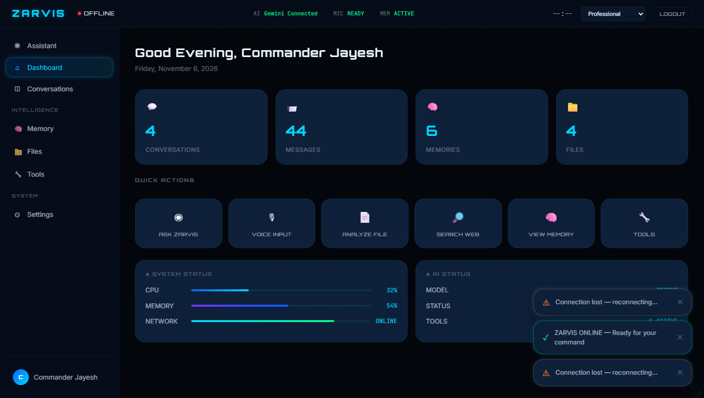

---

### 8. 💬 Multi-Session Conversation Manager
*Full conversation history repository with instant real-time search filtering, session timestamps, 1-click thread restoration, and session lifecycle management.*

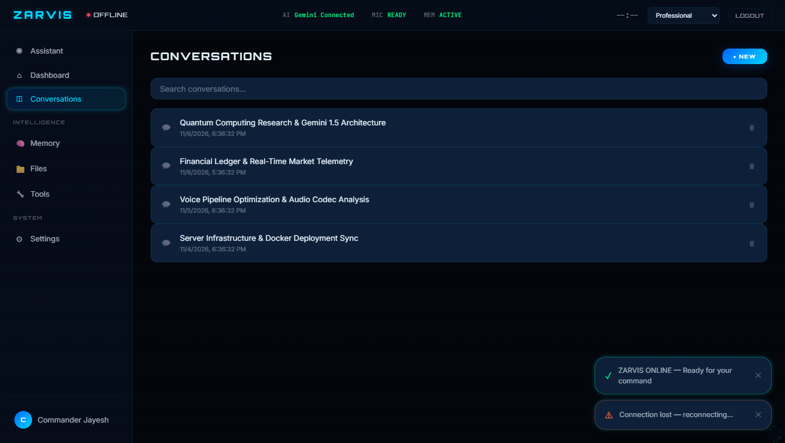

---

### 9. 🧠 Persistent Long-Term Memory Matrix
*Categorized neural memory bank (`User Preferences`, `Active Projects`, `Personal Context`) allowing ZARVIS to retain key facts, user preferences, and project context across sessions.*

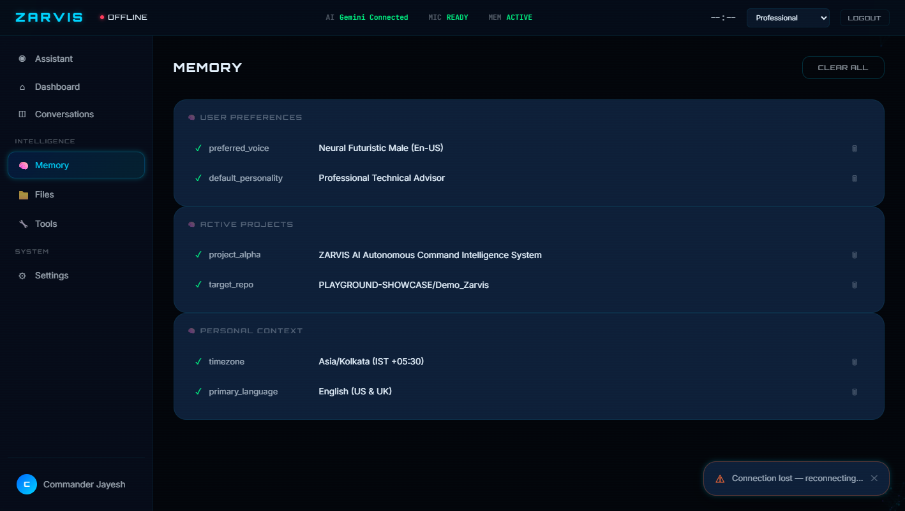

---

### 10. 🔧 Modular AI Tools Registry
*Extensible tool catalog showcasing active capabilities including **Calculator**, **Weather Telemetry**, **Atomic Time Sync**, **DuckDuckGo Web Search**, and **System Hardware Status**.*

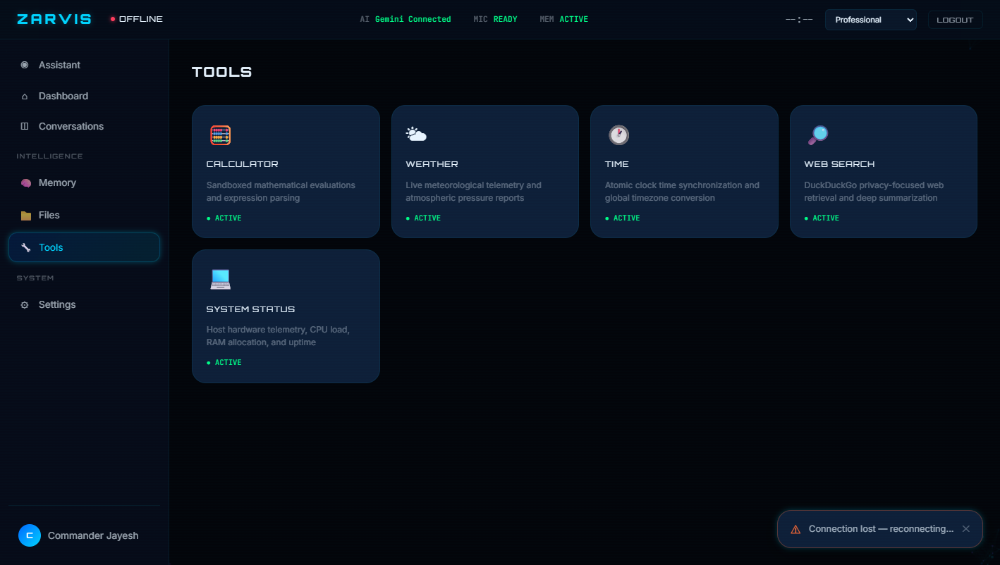

---

### 11. 📁 Multimodal Knowledge Vault & Document Analyzer
*Drag-and-drop file ingestion center supporting PDFs, DOCX, CSV spreadsheets, JSON, TXT, and images (up to 50MB) for instant AI summarization and Q&A.*

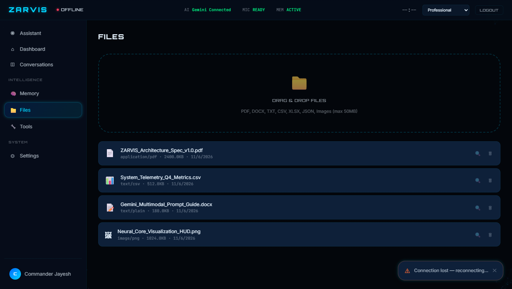

---

### 12. ⚙️ System Configuration & Voice Synthesis Tuning
*Granular control center for selecting the underlying Gemini model (`Gemini 1.5 Pro` / `Flash`), response style, creativity temperature (`0.0 – 1.0`), auto-speak toggle, speech rate, and voice pitch.*

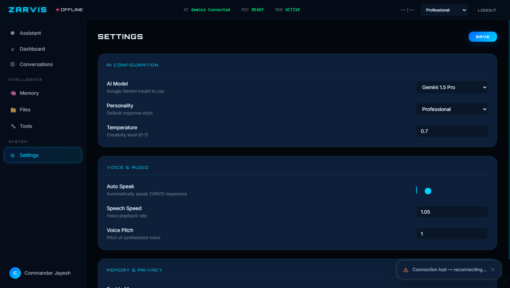

---

### 13. ⌘ Instant Command Palette (`Ctrl + K`)
*Keyboard-driven HUD spotlight overlay for rapid navigation, voice toggling (`Space`), file uploads, web searches, and session creation without leaving the keyboard.*

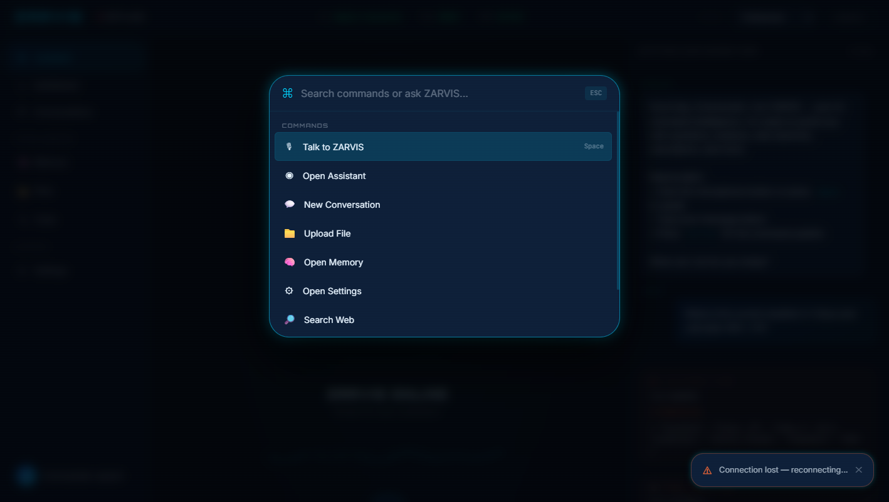

---

## 🔄 End-to-End Project & Interface Workflow

### 1. 🖥️ User Interface Navigation & State Workflow
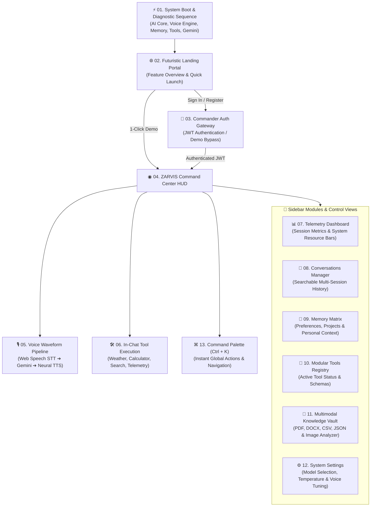

### 2. ⚡ Real-Time Voice, AI & Autonomous Tool Execution Pipeline
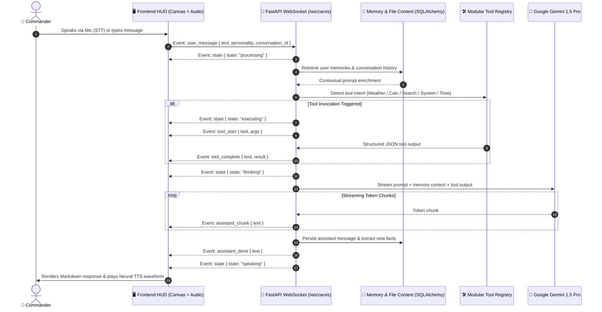

---

## ✨ Key Features & Capabilities

| Domain | Capabilities |
| :--- | :--- |
| **🎙️ Voice Intelligence** | Real-time Speech-to-Text (STT), neural Text-to-Speech (TTS), wake-word detection, barge-in voice interruption, and live audio waveform rendering. |
| **🧠 Gemini AI Engine** | Streaming token generation via `google-generativeai`, 7 distinct AI personality modes, context-aware prompting, and multimodal analysis. |
| **⚡ Autonomous Tools** | Built-in tool registry for live Weather lookup, safe AST-based Calculator, DuckDuckGo Web Search, System Telemetry (`psutil`), and Timezone sync. |
| **💾 Persistent Memory** | Automatic & manual fact extraction categorized by preferences, projects, and personal context stored in SQLAlchemy/PostgreSQL/SQLite. |
| **📄 Multimodal Files** | Upload and parse `.pdf`, `.docx`, `.csv`, `.xlsx`, `.json`, `.txt`, and images (`.png`, `.jpg`, `.webp`) with 1-click AI deep analysis. |
| **🎨 Cybernetic HUD UI** | Pure ES6+ modular component architecture, custom 60fps HTML5 Canvas particle & core animations, dark glassmorphism design system, and `Ctrl+K` palette. |
| **🔒 Enterprise Security** | Bcrypt password hashing, JWT bearer authentication, server-side API key isolation, CORS protection, and sandboxed tool execution. |

---

## 🏗️ System Architecture

```text
zarvis/
├── screenshots/                  # Full visual tour & UI screenshots
├── backend/
│   ├── app/
│   │   ├── main.py               # FastAPI application & lifespan entry point
│   │   ├── config.py             # Pydantic settings & environment configuration
│   │   ├── database.py           # Async SQLAlchemy ORM models (User, Conversation, Message, Memory, File)
│   │   ├── auth.py               # JWT token generation, verification & password hashing
│   │   ├── api/                  # RESTful API routers
│   │   │   ├── auth.py           # /api/auth (Register, Login, Profile)
│   │   │   ├── conversations.py  # /api/conversations (CRUD & message history)
│   │   │   └── resources.py      # /api/memory, /api/tools, /api/files, /api/settings
│   │   ├── ai/
│   │   │   └── gemini_service.py # Google Gemini streaming & tool-calling orchestrator
│   │   ├── websocket/
│   │   │   ├── manager.py        # Active WebSocket connection pool manager
│   │   │   └── routes.py         # Bi-directional real-time event loop (/ws/zarvis)
│   │   ├── tools/
│   │   │   └── registry.py       # Pluggable tool execution framework
│   │   └── memory/
│   │       └── service.py        # Persistent user memory CRUD service
│   ├── Dockerfile
│   ├── requirements.txt
│   └── .env.example
├── frontend/
│   ├── index.html                # Entry HTML with Orbitron, Inter & JetBrains Mono fonts
│   ├── src/
│   │   ├── main.js               # Application bootstrapper
│   │   ├── components/
│   │   │   ├── App.js            # Core state machine & view router
│   │   │   ├── ZarvisCore.js     # Interactive 2D/3D Canvas AI core visualizer
│   │   │   ├── CommandPalette.js # Ctrl+K spotlight command modal
│   │   │   ├── NotificationCenter.js
│   │   │   └── ParticleBackground.js
│   │   ├── services/
│   │   │   ├── api.js            # REST client & auto-reconnecting WebSocket client
│   │   │   └── audio.js          # Web Speech API (STT/TTS) & AudioContext visualizer
│   │   └── styles/
│   │       └── main.css          # Cybernetic dark glassmorphism design system
│   ├── Dockerfile
│   └── nginx.conf
├── scripts/
│   ├── init_db.py                # Database schema initializer
│   └── capture_all_screenshots.py# Automated headless Chrome CDP screenshot generator
├── tests/
│   ├── test_auth.py              # Authentication unit tests
│   └── test_tools.py             # Tool execution unit tests
├── docker-compose.yml            # Full-stack multi-container orchestration
└── start.bat                     # 1-click Windows launcher script
```

---

## 🔌 Real-Time WebSocket Protocol (`/ws/zarvis`)

| Direction | Event Type | Payload / Description |
| :--- | :--- | :--- |
| **Client ➔ Server** | `user_message` | `{ text, personality, conversation_id }` — Sends user voice transcript or text query. |
| **Client ➔ Server** | `stop` | Interrupts ongoing AI generation or voice synthesis immediately. |
| **Server ➔ Client** | `init` | `{ demo_mode, gemini_available }` — Handshake status on connection. |
| **Server ➔ Client** | `state` | `{ state }` — Transitions UI core (`idle`, `listening`, `processing`, `thinking`, `speaking`, `executing`). |
| **Server ➔ Client** | `tool_start` | `{ tool, args }` — Renders live running tool card in chat stream. |
| **Server ➔ Client** | `tool_complete` | `{ tool, result }` — Updates tool card with structured JSON output. |
| **Server ➔ Client** | `assistant_chunk` | `{ text }` — Streams real-time token chunks from Google Gemini. |
| **Server ➔ Client** | `assistant_done` | `{ text }` — Finalizes message bubble and triggers neural TTS playback. |

---

## 🚀 Getting Started

### Prerequisites
- **Python 3.11+**
- **Google Gemini API Key** ([Get one from Google AI Studio](https://aistudio.google.com/app/apikey))
- *(Optional)* **Docker & Docker Compose** for containerized deployment

### Option 1: 1-Click Windows Quick Start
Simply double-click `start.bat` or run from terminal:
```cmd
start.bat
```
This automatically launches the FastAPI backend on `http://localhost:8000`, serves the frontend on `http://localhost:3000`, and opens your default browser.

### Option 2: Manual Setup

#### 1. Clone the Repository
```bash
git clone https://github.com/PLAYGROUND-SHOWCASE/AI_CHATBOT.git
cd AI_CHATBOT
```

#### 2. Configure & Start Backend
```bash
cd backend

# Create and activate virtual environment
python -m venv .venv
.venv\Scripts\activate      # Windows
# source .venv/bin/activate # macOS/Linux

# Install dependencies
pip install -r requirements.txt

# Configure environment variables
cp .env.example .env
# Edit .env and set your GEMINI_API_KEY
```

Start the FastAPI server:
```bash
uvicorn app.main:app --reload --port 8000
```
- **Backend API**: `http://localhost:8000`
- **Interactive Swagger Docs**: `http://localhost:8000/api/docs`

#### 3. Start Frontend
Open a new terminal in the `frontend` directory:
```bash
cd frontend
python -m http.server 3000
```
Open **`http://localhost:3000`** in Chrome or Edge.

> 💡 **Instant Demo Mode**: Want to explore the UI without setting up the backend? Open `http://localhost:3000` and click **"Try Demo Mode"** on the landing or login screen!

---

## 🐳 Docker Deployment

Run the entire stack (Frontend + Backend + PostgreSQL + Redis) with a single command:

```bash
cp backend/.env.example .env
# Add your GEMINI_API_KEY to .env

docker compose up -d --build
```

---

## ⌨️ Keyboard Shortcuts

| Shortcut | Action |
| :--- | :--- |
| `Space` | Toggle microphone voice listening / interrupt speech |
| `Ctrl / Cmd + K` | Open Spotlight Command Palette |
| `Enter` | Send chat message |
| `Shift + Enter` | Insert newline in chat input |
| `Escape` | Close active modal / cancel current operation |

---

## 🧪 Running Tests

```bash
cd backend
pytest ../tests/ -v
```

---

## 📄 License

This project is licensed under the **MIT License**.

---

<p align="center">
  <b>ZARVIS — AI Command Intelligence</b><br>
  <i>Talk. Think. Analyze. Execute.</i>
</p>
